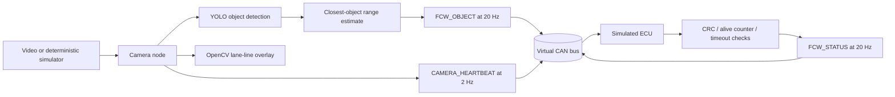

# Camera-to-CAN Forward Collision Warning

[](https://github.com/adi-bytes/camera-can-fcw-simulation/actions/workflows/test.yml)

A Python prototype that connects a camera-perception pipeline to a **simulated CAN network**. A camera node identifies the closest road user, estimates its range, and broadcasts it over a DBC-defined virtual CAN bus. A simulated ECU validates the message and publishes a forward-collision-warning (FCW) status.

> **Simulation only.** This project uses UDP multicast or Linux SocketCAN `vcan`; it has not been tested with physical CAN hardware, a vehicle, or safety-certified components. It must not be used to control a vehicle or make real driving decisions.

## Architecture



## Features

- **Virtual CAN:** cross-process UDP multicast by default; Linux `vcan` is also supported.
- **DBC-defined interface:** `FCW_OBJECT`, `CAMERA_HEARTBEAT`, and `FCW_STATUS` are described in [`dbc/fcw.dbc`](dbc/fcw.dbc).
- **Message integrity:** CRC-8/SAE-J1850 and a rolling 4-bit alive counter protect object frames.
- **ECU fail-safe behavior:** a 150 ms watchdog, malformed-frame handling, and a debounced recovery path. Three consecutive valid frames are required after a fault.
- **Fault injection:** intentionally drop frames, corrupt the CRC, or hold the alive counter to demonstrate fault handling.
- **Perception demo:** deterministic simulation for repeatable testing plus an optional YOLO/OpenCV video path.
- **Automated checks:** pytest covers protocol, ECU recovery, timeout behavior, and DBC/Python contract consistency; GitHub Actions runs the suite on pushes and pull requests.

## CAN interface

All messages are standard 11-bit CAN frames with Intel/little-endian signals.

| CAN ID | Message | Nominal rate | Purpose |
|---|---|---:|---|
| `0x180` | `FCW_OBJECT` | 20 Hz | Closest-object range, class, confidence, alive counter, CRC-8 |
| `0x181` | `CAMERA_HEARTBEAT` | 2 Hz | Camera-node liveness and state |
| `0x280` | `FCW_STATUS` | 20 Hz | Warning state, safe-state indication, fault reason, data age |

`FCW_OBJECT` calculates CRC-8/SAE-J1850 (polynomial `0x1D`, init/xorout `0xFF`) across bytes 0–6; byte 7 carries the checksum. The ECU enters a safe state on a CRC mismatch, unexpected alive-counter value, malformed frame, or object-frame timeout.

## Quick start

Requires Python 3.10 or newer.

```bash
git clone https://github.com/adi-bytes/camera-can-fcw-simulation.git
cd camera-can-fcw-simulation
python -m venv .venv
```

Activate the environment and install the package:

```powershell
# Windows PowerShell
.venv\Scripts\Activate.ps1
pip install -e .
```

```bash
# macOS / Linux
source .venv/bin/activate
pip install -e .
```

Start the ECU in one terminal:

```bash
python -m fcw.ecu_node --channel 239.255.60.60
```

Start the repeatable camera simulation in another:

```bash
python -m fcw.camera_node --simulate --channel 239.255.60.60
```

The simulator cycles a car through approaching and receding distances. When the range is below the default 8 m threshold, the ECU reports an active warning.

## Fault-injection demo

Append one of these options to the camera-node command:

```bash
--fault corrupt-crc --fault-after 3
--fault drop --fault-after 3
--fault stuck-counter --fault-after 3
```

The ECU logs the fault and remains in its safe state until it receives three consecutive valid, in-sequence object frames.

## Video mode

```bash
python -m fcw.camera_node --video path/to/dashcam.mp4 --weights yolov8n.pt --show
```

The default `yolov8n.pt` is a COCO model. It can map cars, motorcycles, bicycles, and people into this project’s class model; custom weights can provide labels such as `auto_rickshaw` or `speed_breaker`.

Range is a monocular approximation based on bounding-box height, a configurable focal length, and an assumed target height. The OpenCV lane lines are a visual overlay only: they do not identify the ego lane and are not used to suppress warnings. Video-mode message timing depends on available inference performance; the deterministic simulator is the recommended mode for the 20 Hz communications demonstration.

## Linux SocketCAN option

```bash
sudo modprobe vcan
sudo ip link add dev vcan0 type vcan
sudo ip link set up vcan0
```

Then run both nodes with `--interface socketcan --channel vcan0`.

## Test

```bash
pytest -q
```

## Repository layout

```text
dbc/fcw.dbc             DBC message and signal contract
src/fcw/protocol.py     DBC encoding, decoding, CRC, and virtual-bus helpers
src/fcw/camera_node.py  simulated/video perception producer and fault injector
src/fcw/ecu_node.py     FCW ECU validation, watchdog, and status publisher
tests/                  protocol, contract, and ECU-safety tests
```

## Limitations and next steps

This repository intentionally does not claim a custom dataset, trained-model metrics, camera calibration, physical-CAN validation, or automotive safety certification. Useful next extensions are custom Indian-road-scene training, calibrated range-error measurements, ego-lane/corridor filtering, time-to-collision logic, and measured end-to-end latency on the virtual bus.

## License

Released under the [MIT License](LICENSE).
